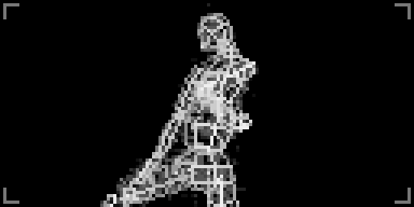
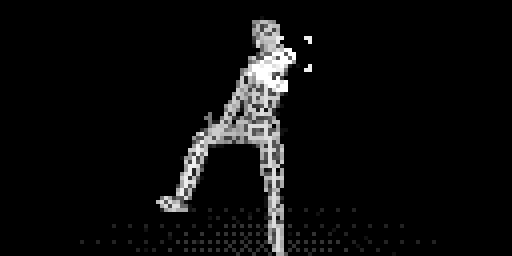
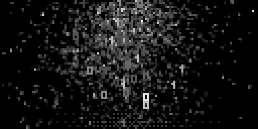

[English](README.md) · **Español** · [Français](README.fr.md) · [Deutsch](README.de.md) · [日本語](README.ja.md) · [中文](README.zh.md) · [हिन्दी](README.hi.md)

# alan

Un cuerpo hecho de datos que suena como un drone. Script para
[monome norns](https://monome.org/docs/norns/): en la pantalla hay una figura
humana en 3D, hecha de puntos, malla y dígitos que caen. Cada parte del
cuerpo es una voz. Al moverla, cambia el sonido.


- **6 voces de drone** que nunca se apagan: torso, cabeza, dos brazos y dos piernas
- **20 articulaciones** para mover desde los encoders, una parte por vez
- **movimiento solo**: el cuerpo se mueve por su cuenta, como una ola que
  recorre las articulaciones
- **cámara libre**: zoom, órbita y altura; se puede atravesar la figura
- **respiración y latido**: el pecho se infla y el corazón se acelera con el
  esfuerzo
- **desintegración**: el cuerpo y el sonido se rompen en partículas y granos
- **8 lugares de poses** (7 de fábrica) para guardar y cargar
- 6 escalas y tónica ajustable, para que todo quede afinado

## Requisitos

- norns (cualquiera: shield, estándar o fates)
- no hace falta teclado MIDI ni ningún controlador: se toca con los
  encoders y los botones

## Instalación

Desde maiden:

```
;install https://github.com/buenosairesfront/alan
```

Después **reiniciá la norns** (SYSTEM > RESTART) para que compile el engine
nuevo `Turing`, y cargá **alan** desde SELECT.

## Presentación


Al abrir el script aparece la intro U-MA y después un primer plano de la
cabeza de Alan con su nombre. La cámara se aleja hasta mostrar el cuerpo
entero. Cualquier botón o encoder la adelanta.

## Controles

### Mover el cuerpo


| control | acción |
|---|---|
| E1 | elegir parte del cuerpo (arriba a la izquierda aparece un mapa con la parte marcada) |
| E2 / E3 | mover la parte elegida (cada parte tiene dos movimientos) |
| K3 mantener | desintegrar: el cuerpo se deshace en partículas; al soltar, vuelve |
| K2 mantener + E2 | velocidad del movimiento solo |
| K2 mantener + E3 | cantidad del movimiento solo |

Las partes, en orden: cabeza (giro / asentir), hombro izquierdo, codo
izquierdo, cadera izquierda, rodilla y tobillo izquierdos, rodilla y tobillo
derechos, cadera derecha, codo derecho, hombro derecho y cintura (flexión /
torsión).

Con el movimiento solo prendido, la parte que tocás queda en tus manos unos
segundos y después se suma otra vez a la ola.

### Cámara



Tocá **K2** para entrar o salir del modo cámara (las esquinas de la pantalla
se marcan).

| control | acción |
|---|---|
| E1 | zoom: al acercarse, la cámara apunta a la cabeza; si seguís, atraviesa la figura y la mira desde el otro lado |
| E2 | órbita alrededor del cuerpo |
| E3 | altura (da la vuelta completa) |

Si no tocás nada durante 8 segundos, la cámara orbita sola (se puede apagar
en PARAMS).

### Poses y afinación (K1 mantenido)



| control | acción |
|---|---|
| K1 + E1 | elegir pose (1 a 8): el cuerpo va pasando por cada una mientras girás |
| K1 + K2 | guardar la pose actual en ese lugar |
| K1 + K3 | cargar la pose de ese lugar |
| K1 + E2 | respiración |
| K1 + E3 | tónica |

Las poses que guardás quedan en `data/alan/poses.tab` y reemplazan a las de
fábrica en ese lugar.

## Cómo suena


Cada parte del cuerpo maneja una voz. Las notas siempre caen en la escala
elegida.

| voz | sonido | qué la cambia |
|---|---|---|
| torso | sub grave, latido y aire | doblarse oscurece; la torsión abre un coro de sierras |
| cabeza | coro que canta vocales | mirar arriba sube la nota; girar la cabeza cambia la vocal (a e i o u) |
| brazos | tendón resonante (ruido frotado sobre resonadores) | la altura de la mano es la nota, el alcance abre el filtro, el codo doblado vuelve el timbre inarmónico |
| piernas | hueso y madera graves | la altura del pie es la nota, abrir la cadera abre el filtro, la rodilla doblada cruje |

- Cuanto más lejos de su posición de reposo está una parte, más fuerte suena
  su voz.
- Moverse rápido hace sonar más fuerte y más brillante, y suelta partículas
  en la pantalla.
- El paneo y la reverb salen de la cámara: lo que está a la izquierda en la
  pantalla suena a la izquierda, y lo lejano suena más lejos.
- El latido se acelera con el esfuerzo de la pose y con el movimiento.



## Parámetros

En PARAMS > alan:

| parámetro | qué hace |
|---|---|
| tónica | nota base, de E1 a E3 |
| escala | dórico, eólico, frigio, lidio, pentatónica o quintas |
| respiración | cuánto respira el cuerpo (y el sonido) |
| movimiento solo | cantidad del movimiento automático |
| movimiento velocidad | de un ciclo cada 50 s a uno cada 2,4 s |
| desintegración base | deja el cuerpo siempre un poco deshecho |
| auto órbita | la cámara gira sola después de 8 s sin tocar nada |
| espacio (reverb) | tamaño de la reverb |
| volumen | volumen general |
| cuerpo | las 20 articulaciones, una por una (sirven para mapear MIDI) |

Los ajustes se guardan solos al salir del script.

## Archivos

- `alan.lua`: el script
- `lib/Engine_Turing.sc`: el motor de sonido en SuperCollider
- `lib/alan_title.bin`: el título de la presentación
- `lib/uma_splash*.lua`, `lib/uma_particles.wav`: la intro U-MA

<!-- u-ma:more -->
**Más de U-MA:** todos los instrumentos y herramientas en un solo lugar → [muestrario U-MA](https://github.com/buenosairesfront/U-ma/blob/main/README.es.md)
<!-- /u-ma:more -->

## Créditos

Hecho por [Buenos Aires Front](https://github.com/buenosairesfront) / U-MA.
Licencia MIT.
