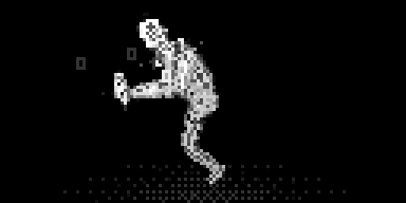

[English](README.md) · [Español](README.es.md) · **Français** · [Deutsch](README.de.md) · [日本語](README.ja.md) · [中文](README.zh.md) · [हिन्दी](README.hi.md)

# alan

Un corps fait de données qui sonne comme un drone. Script pour
[monome norns](https://monome.org/docs/norns/) : l'écran montre une figure
humaine en 3D faite de points, d'un maillage et de chiffres qui tombent.
Chaque partie du corps est une voix. Quand on la bouge, le son change.


- **6 voix de drone** qui ne s'arrêtent jamais : torse, tête, deux bras et deux jambes
- **20 articulations** à bouger avec les encodeurs, une partie à la fois
- **mouvement autonome** : le corps bouge tout seul, comme une vague qui
  parcourt les articulations
- **caméra libre** : zoom, orbite et hauteur ; on peut traverser la figure
- **respiration et battement de cœur** : la poitrine se gonfle et le cœur
  accélère avec l'effort
- **désintégration** : le corps et le son se brisent en particules et en grains
- **8 emplacements de poses** (7 d'usine) pour sauvegarder et rappeler
- 6 gammes et une tonique réglable, pour que tout reste juste

## Prérequis

- norns (n'importe lequel : shield, standard ou fates)
- pas besoin de clavier MIDI ni de contrôleur : on joue avec les encodeurs
  et les boutons

## Installation

Depuis maiden :

```
;install https://github.com/buenosairesfront/alan
```

Ensuite **redémarrez norns** (SYSTEM > RESTART) pour compiler le nouveau
moteur `Turing`, puis chargez **alan** depuis SELECT.

## Présentation


À l'ouverture du script apparaît l'intro U-MA, puis un gros plan de la tête
d'Alan avec son nom. La caméra recule jusqu'à montrer le corps entier.
N'importe quel bouton ou encodeur fait avancer.

## Contrôles

### Bouger le corps


| contrôle | action |
|---|---|
| E1 | choisir une partie du corps (une petite carte en haut à gauche la montre) |
| E2 / E3 | bouger la partie choisie (chaque partie a deux mouvements) |
| K3 maintenu | désintégrer : le corps se défait en particules ; en relâchant, il revient |
| K2 maintenu + E2 | vitesse du mouvement autonome |
| K2 maintenu + E3 | quantité du mouvement autonome |

Les parties, dans l'ordre : tête (rotation / hochement), épaule gauche, coude
gauche, hanche gauche, genou et cheville gauches, genou et cheville droits,
hanche droite, coude droit, épaule droite et taille (flexion / torsion).

Avec le mouvement autonome activé, la partie que vous touchez reste entre vos
mains quelques secondes, puis rejoint la vague.

### Caméra


Appuyez sur **K2** pour entrer ou sortir du mode caméra (les coins de l'écran
sont marqués).

| contrôle | action |
|---|---|
| E1 | zoom : de près, la caméra vise la tête ; en continuant, elle traverse la figure et la regarde de l'autre côté |
| E2 | orbite autour du corps |
| E3 | hauteur (fait le tour complet) |

Si rien n'est touché pendant 8 secondes, la caméra orbite toute seule (on
peut le désactiver dans PARAMS).

### Poses et accord (K1 maintenu)


| contrôle | action |
|---|---|
| K1 + E1 | choisir une pose (1 à 8) : le corps passe par chacune pendant que vous tournez |
| K1 + K2 | sauvegarder la pose actuelle à cet emplacement |
| K1 + K3 | charger la pose de cet emplacement |
| K1 + E2 | respiration |
| K1 + E3 | tonique |

Les poses sauvegardées sont dans `data/alan/poses.tab` et remplacent la pose
d'usine de cet emplacement.

## Comment ça sonne



Chaque partie du corps pilote une voix. Les notes tombent toujours dans la
gamme choisie.

| voix | son | ce qui la change |
|---|---|---|
| torse | sub grave, battement de cœur et souffle | se pencher l'assombrit ; la torsion ouvre un chœur de dents de scie |
| tête | un chœur qui chante des voyelles | lever la tête monte la note ; la tourner change la voyelle (a e i o u) |
| bras | tendon résonant (bruit frotté à travers des résonateurs) | la hauteur de la main est la note, la portée ouvre le filtre, le coude plié rend le timbre inharmonique |
| jambes | os et bois graves | la hauteur du pied est la note, ouvrir la hanche ouvre le filtre, le genou plié craque |

- Plus une partie s'éloigne de sa position de repos, plus sa voix est forte.
- Bouger vite rend le son plus fort et plus brillant, et lance des particules
  à l'écran.
- Le panoramique et la réverbération viennent de la caméra : ce qui est à
  gauche de l'écran sonne à gauche, et ce qui est loin sonne lointain.
- Le battement de cœur accélère avec l'effort de la pose et avec le mouvement.


## Paramètres

Dans PARAMS > alan :

| paramètre | ce qu'il fait |
|---|---|
| tonica | tonique, de Mi1 à Mi3 |
| escala | gamme : dorien, éolien, phrygien, lydien, pentatonique ou quintes |
| respiracion | combien le corps (et le son) respire |
| movimiento solo | quantité de mouvement autonome |
| movimiento velocidad | d'un cycle toutes les 50 s à un toutes les 2,4 s |
| desintegracion base | garde le corps toujours un peu défait |
| auto orbita | la caméra tourne seule après 8 s sans action |
| espacio (reverb) | taille de la réverbération |
| volumen | volume général |
| cuerpo | les 20 articulations, une par une (pratique pour le mapping MIDI) |

Les noms des paramètres sont en espagnol sur l'appareil. Les réglages sont
enregistrés en quittant le script.

## Fichiers

- `alan.lua` : le script
- `lib/Engine_Turing.sc` : le moteur sonore en SuperCollider
- `lib/alan_title.bin` : le titre de la présentation
- `lib/uma_splash*.lua`, `lib/uma_particles.wav` : l'intro U-MA

<!-- u-ma:more -->
**Plus de U-MA :** tous les instruments et outils au même endroit → [vitrine U-MA](https://github.com/buenosairesfront/U-ma/blob/main/README.fr.md)
<!-- /u-ma:more -->

## Crédits

Créé par [Buenos Aires Front](https://github.com/buenosairesfront) / U-MA.
Licence MIT.
