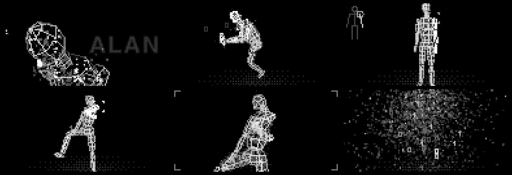
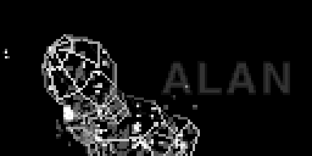
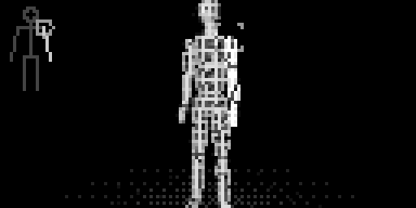

[English](README.md) · [Español](README.es.md) · [Français](README.fr.md) · [Deutsch](README.de.md) · **日本語** · [中文](README.zh.md) · [हिन्दी](README.hi.md)

# alan

データでできた体が、ドローンのように鳴る。[monome norns](https://monome.org/docs/norns/) 用のスクリプトです。画面には点、ワイヤーメッシュ、落ちてくる数字でできた 3D の人体が映ります。体の各部分がひとつの声で、動かすと音が変わります。



- 鳴りやまない **6 つのドローン・ボイス**：胴、頭、両腕、両脚
- エンコーダーで動かす **20 の関節**（一度にひとつの部位）
- **自動の動き**：関節を波が伝わるように、体が自分で動く
- **自由なカメラ**：ズーム、周回、高さ。体の中を通り抜けることもできる
- **呼吸と鼓動**：胸がふくらみ、負荷がかかると心臓が速くなる
- **崩壊**：体と音が粒子とグレインに砕ける
- **8 つのポーズ・スロット**（工場出荷ポーズ 7 つ）で保存と呼び出し
- 6 つの音階と調整できる主音で、いつも調和したまま

## 必要なもの

- norns（shield、標準、fates のどれでも）
- MIDI キーボードやコントローラーは不要。エンコーダーとキーで演奏します

## インストール

maiden から：

```
;install https://github.com/buenosairesfront/alan
```

その後、新しいエンジン `Turing` をコンパイルするために **norns を再起動**（SYSTEM > RESTART）し、SELECT から **alan** を読み込みます。

## イントロ



スクリプトを開くと U-MA のイントロが流れ、続いて名前とともに Alan の顔のアップが現れます。カメラは体全体が見えるまで引いていきます。どのキーやエンコーダーでも先に進めます。

## 操作

### 体を動かす



| 操作 | 動作 |
|---|---|
| E1 | 体の部位を選ぶ（左上の小さな図に選んだ部位が表示される） |
| E2 / E3 | 選んだ部位を動かす（各部位に 2 つの動き） |
| K3 長押し | 崩壊：体が粒子になってほどける。離すと元に戻る |
| K2 長押し + E2 | 自動の動きの速さ |
| K2 長押し + E3 | 自動の動きの量 |

部位の順番：頭（回す／うなずく）、左肩、左ひじ、左股関節、左ひざと足首、右ひざと足首、右股関節、右ひじ、右肩、腰（曲げる／ひねる）。

自動の動きがオンのとき、触った部位は数秒間あなたの手に残り、そのあと再び波に加わります。

### カメラ


**K2** を押すとカメラ・モードに入る／出る（画面の四隅に印が付く）。

| 操作 | 動作 |
|---|---|
| E1 | ズーム：近づくとカメラは頭を向く。さらに回すと体を通り抜け、反対側から見る |
| E2 | 体のまわりを周回 |
| E3 | 高さ（一周できる） |

8 秒間なにも触らないと、カメラが自動で周回します（PARAMS でオフにできます）。

### ポーズと調律（K1 長押し）


| 操作 | 動作 |
|---|---|
| K1 + E1 | ポーズを選ぶ（1〜8）：回すあいだ体が各ポーズを通っていく |
| K1 + K2 | 今のポーズをそのスロットに保存 |
| K1 + K3 | そのスロットのポーズを読み込む |
| K1 + E2 | 呼吸 |
| K1 + E3 | 主音 |

保存したポーズは `data/alan/poses.tab` に入り、そのスロットの工場出荷ポーズと置き換わります。

## 音の仕組み


体の各部位がひとつの声を動かします。音はいつも選んだ音階に収まります。

| 声 | 音 | 何で変わるか |
|---|---|---|
| 胴 | 深いサブ、鼓動、息 | 前に曲げると暗く、ひねるとノコギリ波のコーラスが開く |
| 頭 | 母音を歌うコーラス | 上を向くと音が上がり、首を回すと母音が変わる（a e i o u） |
| 腕 | 共鳴する腱（レゾネーターでこすったノイズ） | 手の高さが音程、届く距離でフィルターが開き、ひじを曲げると倍音がずれる |
| 脚 | 低い骨と木の音 | 足の高さが音程、股関節を開くとフィルターが開き、ひざを曲げるとパチパチ鳴る |

- 部位が休みの姿勢から離れるほど、その声は大きくなります。
- 速く動くと音が大きく明るくなり、画面に粒子が飛びます。
- パンとリバーブはカメラで決まります。画面の左にあるものは左から聞こえ、遠いものは遠くに聞こえます。
- 鼓動はポーズの負荷と動きで速くなります。


## パラメーター

PARAMS > alan：

| パラメーター | 内容 |
|---|---|
| tonica | 主音（E1〜E3） |
| escala | 音階：ドリアン、エオリアン、フリジアン、リディアン、ペンタトニック、5 度 |
| respiracion | 体（と音）の呼吸の深さ |
| movimiento solo | 自動の動きの量 |
| movimiento velocidad | 50 秒に 1 回から 2.4 秒に 1 回まで |
| desintegracion base | 体をいつも少し崩れた状態にする |
| auto orbita | 8 秒操作がないとカメラが自動で回る |
| espacio (reverb) | リバーブの大きさ |
| volumen | 全体の音量 |
| cuerpo | 20 の関節をひとつずつ（MIDI マッピングに便利） |

本体ではパラメーター名はスペイン語です。設定はスクリプトを終了すると保存されます。

## ファイル

- `alan.lua`：スクリプト本体
- `lib/Engine_Turing.sc`：SuperCollider のサウンド・エンジン
- `lib/alan_title.bin`：イントロのタイトル
- `lib/uma_splash*.lua`、`lib/uma_particles.wav`：U-MA のイントロ

<!-- u-ma:more -->
**U-MA のほかの作品：** すべての楽器とツールをひとつに → [U-MA ショーケース](https://github.com/buenosairesfront/U-ma/blob/main/README.ja.md)
<!-- /u-ma:more -->

## クレジット

制作：[Buenos Aires Front](https://github.com/buenosairesfront) / U-MA。
MIT ライセンス。
